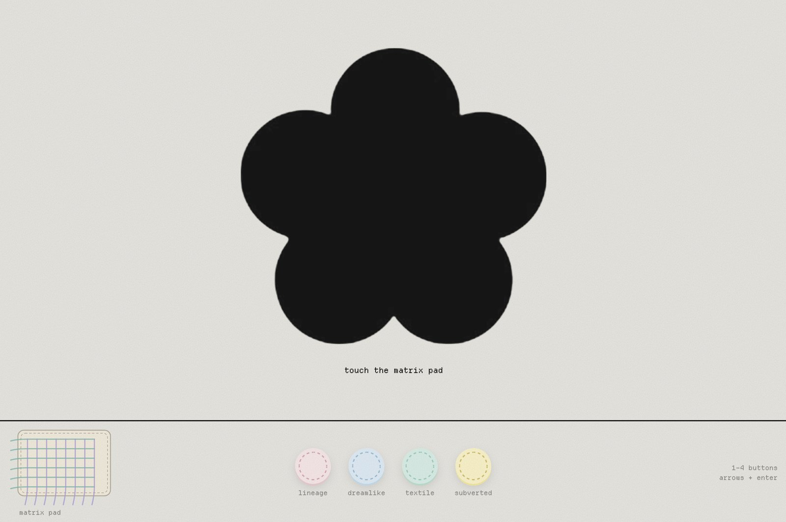
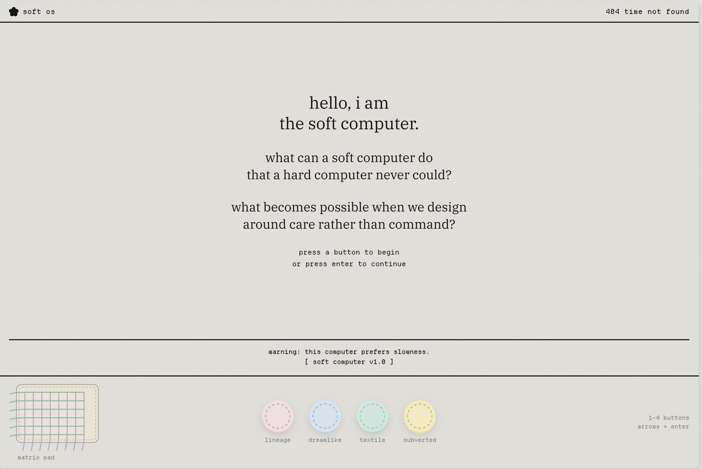
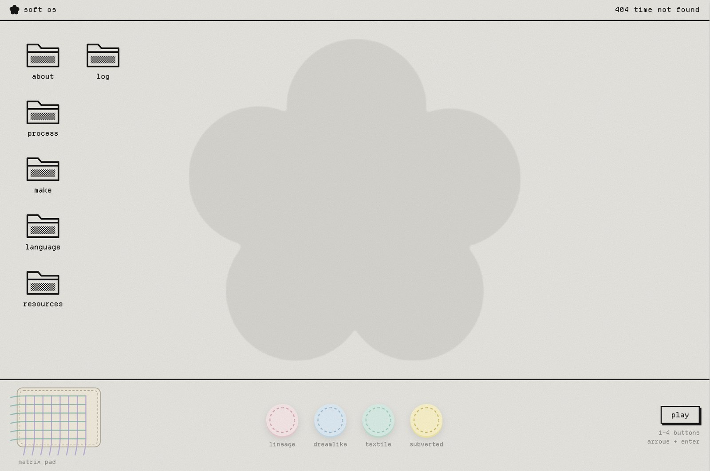
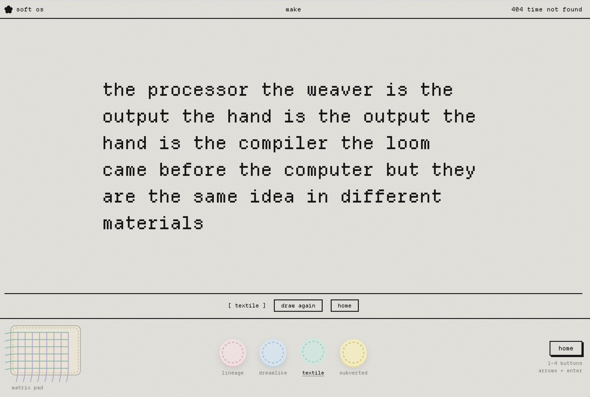
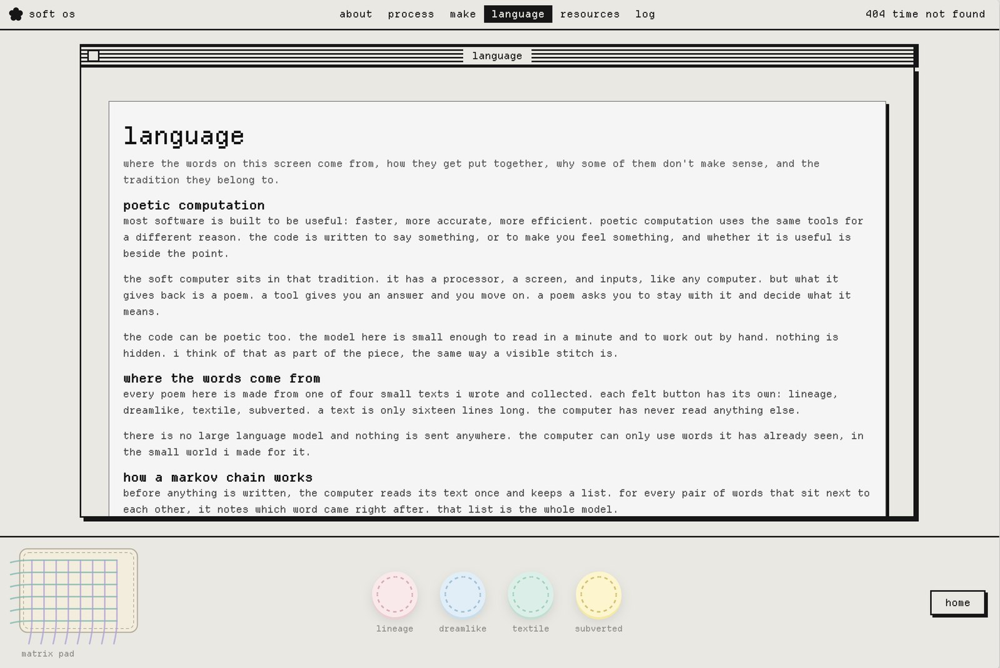

# soft.computer

notes, experiments, and progress from the making of [the soft computer](https://thesoft.computer) — a textile-based computing object that imagines a gentler way of being with technology.

this repo is the source for **thesoft.computer**: the process log, documentation, and interactive pieces that accompany the physical object. it is not the firmware for the object itself — this is the website.

live site: [thesoft.computer](https://thesoft.computer)
about the project: [thesoft.computer/about](https://thesoft.computer/about)

---

## what's in here

a [Next.js](https://nextjs.org) app (app router) with a few distinct areas:

| route | what it is |
|---|---|
| `/` | soft os — the whole page is the soft computer's e-ink screen, with its matrix pad and four felt buttons underneath. runs the same corpus + markov chain logic as the physical object, in-browser |
| `/about` | full project write-up: concept, materials, electronics, corpus design, user testing |
| `/process` | process notes |
| `/make` | a build guide for anyone who wants to make their own soft computer |
| `/language` | how the soft computer writes: the four corpora, how a markov chain works (with a step-by-step demo), and why some of it doesn't make sense |
| `/resources` | reading list, pulled live from a zotero collection |
| `/log` | dated process log / notebook |
| `/punch` | a punch-card-style calendar view of log entries |
| `/timeline` | project timeline |
| `/admin` | password-gated log editor (not for public use) |

## soft os

the site behaves like the object's operating system. every page stays inside the same frame: the `soft os` bar on top, the e-ink screen in the middle, the matrix pad and felt buttons along the bottom.

the homepage runs in this order:

1. **flower** — the screen waits with the blossom, like the real one does

   

2. **hello** — touch the matrix pad (or press enter) and it says hello

   

3. **desktop** — press enter to reach the folders: about, process, make, language, resources, log

   

4. **play** — press a felt button, or the play button, and a poem fills the screen

   

controls:

| input | what it does |
|---|---|
| matrix pad | presence: wakes the screen, moves on from hello, draws a new poem during play |
| felt buttons (or keys `1`–`4`) | pick a corpus — lineage, dreamlike, textile, subverted — and start play |
| `enter` | wake / continue |
| arrow keys | move between folders |
| `esc` or home | leave play and go back to the folders |

folders open their page in a window inside the screen. the close box in the title bar goes back to the desktop. the screen does a full e-ink refresh flicker on each change, which is skipped for anyone with reduced motion turned on. photos sit in grey and show their color on hover.



where things live:

| file | what's in it |
|---|---|
| `src/app/page.js` | the homepage: flower, hello, desktop, play |
| `src/app/eink.module.css` | styles for the screen, pad, and felt buttons |
| `src/lib/softText.js` | the four corpora and the order-2 markov chain |
| `src/lib/feltButtons.js` | the felt buttons' colors and names |
| `src/components/SoftDock.js` | matrix pad + felt buttons, shared by every page |
| `src/components/Nav.js`, `OsDock.js` | the bar, window title, and dock around the other pages |
| `src/components/ChainDemo.js` | the step-by-step markov demo on `/language` |

## stack

- [Next.js](https://nextjs.org) 16 / React 19
- [Upstash Redis](https://upstash.com/) — log entries, concept images, punch-card data
- [Vercel Blob](https://vercel.com/docs/storage/vercel-blob) — image uploads
- [Zotero API](https://www.zotero.org/support/dev/web_api/v3/start) — resources list
- deployed on [Vercel](https://vercel.com)

## getting started

```bash
git clone https://github.com/yafira/soft-computer.git
cd soft-computer
npm install
npm run dev
```

open [http://localhost:3000](http://localhost:3000).

### environment variables

most of the site (the homepage, `/about`, `/make`, `/language`) runs with no configuration. the following are only needed for the pieces that talk to external services:

```bash
# upstash redis — log, punch card, concept images
UPSTASH_REDIS_REST_URL=
UPSTASH_REDIS_REST_TOKEN=

# vercel blob — image uploads
BLOB_READ_WRITE_TOKEN=

# admin — gates /admin and the log-editing api routes
ADMIN_LOG_PASSWORD=
ADMIN_LOG_TOKEN=
ADMIN_UPLOAD_TOKEN=

# zotero — powers /resources
ZOTERO_USER_ID=
ZOTERO_COLLECTION_KEY=
ZOTERO_API_KEY=
```

copy these into a `.env.local` file. none of this is required just to browse the site locally or read through `/about`, `/make`, and `/language`.

## deploy

the easiest path is [Vercel](https://vercel.com/new), which the live site runs on. connect the repo, add the environment variables above, and deploy.

## license + use

the write-ups, patterns, corpus text, and build documentation for the physical object are open — see [`/make`](https://thesoft.computer/make) if you want to build your own soft computer. this repo (the website code itself) is shared for reference; if you're reusing substantial chunks of it, a credit back to [thesoft.computer](https://thesoft.computer) is appreciated.

## about the project

the soft computer started as a thesis at [NYU ITP](https://itp.nyu.edu/thesis/archive/2026/12305-yafira-martinez/) and is continuing to grow beyond it. full documentation lives at [thesoft.computer/about](https://thesoft.computer/about).

made by [yafira martinez](https://yafira.xyz).